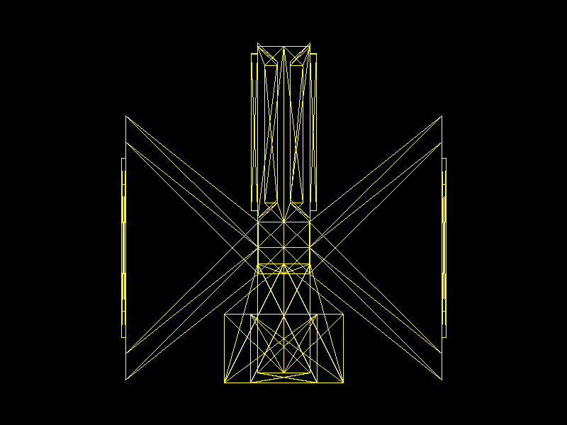

# Lab 4: Carga de modelos

Este programa carga la nave [`assets/Sin_nombre.obj`](assets/Sin_nombre.obj), con 231 vértices y 463 caras triangulares. El cargador lee los vértices y convierte los índices OBJ (que comienzan en 1) a índices de Rust (que comienzan en 0).

Por cada grupo de tres índices, el programa busca sus vértices y dibuja el contorno con la función `triangle`, que utiliza líneas Bresenham y píxeles. La nave se extiende sobre los ejes `x` y `z`, así que se muestran directamente esas coordenadas como una vista desde arriba. El programa la escala y centra automáticamente dentro de la ventana.

## Ejecutar

Desde la raíz del repositorio:

```sh
cargo run
```

Para generar de nuevo la captura:

```sh
cargo run -- --screenshot
```

## Resultado


